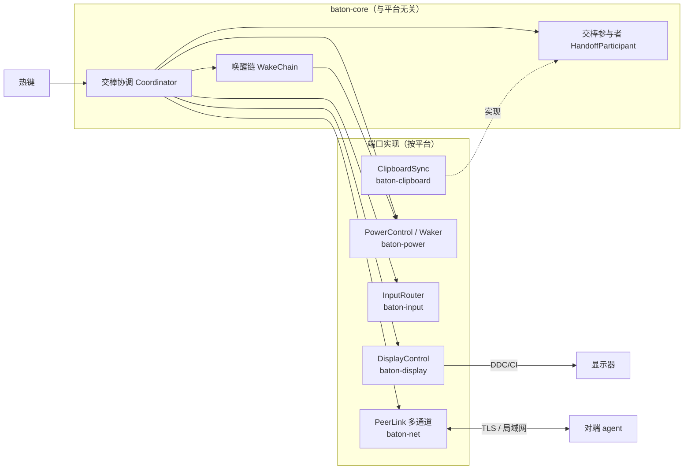

# DeskBaton 首版设计

> 状态：架构已确认（2026-10-16），工程骨架已落地。背景调研见 `docs/research/2026-10-16-kvm-input-switch-landscape.md`。
>
> 修订（2026-10-16）：
> - Mac 不再长期阻止睡眠，改为"交棒后短时保持唤醒 + 唤醒链接管"；
> - 为纯软件（非 KVM）模式和多台机器预留扩展点。
> - 默认保持唤醒策略改为"对端在线期间不睡"（`stay_awake_until = "peer_offline"`），不依赖配件；用户没有 Apple TV / HomePod，不考虑 Bonjour 睡眠代理。HID 配件降回第二期可选项。
> - 新增设备互联：互联层改为"一条 TLS 连接 + 多条逻辑通道"；首个互联能力为剪贴板同步（交棒时随身带过去）。

## 1. 目标

一台显示器、两台电脑（Windows 台式机 + 合盖使用的 Apple Silicon MacBook Pro），按一个热键，把画面和键鼠一起交给另一台电脑；
**切回 Mac 时不需要开盖**。Windows 下线（关机、睡眠）后，Mac 恢复正常睡眠，不会长期不睡。

## 2. 范围

**首版做**

- 两台机器：Windows ×1 + Apple Silicon Mac ×1
- 单台显示器，通过 DDC/CI 写 VCP `0x60` 切输入源
- 键鼠由显示器内置 KVM 跟随输入源（`InputRouting::MonitorKvm`）
- Mac 交棒后保持唤醒，释放条件可配置：`peer_offline`（默认，对端心跳消失即释放）/ `duration`（按 `stay_awake_secs` 计时）
- 接棒方已经睡着时，按配置依次尝试唤醒方式：WoL → HID 唤醒配件（第二期）→ 提示用户
- 局域网配对 + 加密通信，一条连接上多条逻辑通道
- 剪贴板同步：交棒时把文本 / 图片带给接棒方

**预留扩展点，首版不实现**

- 纯软件键鼠模式（`InputRouting::Software`，后端为 Deskflow 进程或自研）
- 不切屏模式（`DisplayMode::None`，每台电脑各有显示器）
- 三台及以上机器（配置和协议里的对端都是列表）
- 剪贴板实时同步模式（`clipboard.sync = "realtime"`）
- 更多互联能力（文件快传、远程电源与状态等）：新增通道 + 交棒参与者即可接入

**不做**

- Linux、Intel Mac；跨网段 / 公网

## 3. 硬件与环境假设

| 项目 | 值 | 是否已验证 |
|---|---|---|
| 显示器 | 泰坦军团 P275MV（Mini-LED，带 KVM，USB-C 65W PD） | 型号已确认 |
| Windows 接法 | DP 视频 + USB-B 上行，有线网 | 已确认 |
| Mac 接法 | 单根 USB-C（视频 + USB + 供电），Wi-Fi，合盖 | 已确认 |
| KVM 跟随输入源（DP ↔ USB-B，USB-C ↔ USB-C） | 来自 MAX 版的社区实测 | **未验证** |
| 输入源编码：DP = `0x0F`，USB-C = `0x1B` | 业界常见值 | **未验证**，做成配置项 |
| 显示器只接受当前活跃输入口发来的 DDC 命令 | 按最坏情况设计 | 不需要验证 |
| 合盖睡眠的 Mac 无法被 KVM 切过来的键盘唤醒 | 用户实际经历 + 推断（键盘在睡眠后才接入，未登记为唤醒源） | 现象已确认，原因未验证 |

## 4. 架构总览

两台机器各运行一个 `deskbaton` agent，结构相同。核心层只依赖端口接口（trait），各平台实现由 agent 组装后注入。



**关键不变量**：任一时刻，键鼠和画面都在同一台机器上，这台机器就是"持棒方"。只有持棒方会响应热键并发 DDC 命令。

## 5. 模块

### 5.1 代码组织（Cargo workspace）

```text
crates/
  baton-core/       领域类型、协议消息、配置、端口接口、唤醒链、协调器。不依赖系统 API，可完整单测
    src/ids.rs          DeviceId / HandoffId / DisplayId / InputCode / MacAddr
    src/config.rs       Config、DisplayMode、InputRouting、PowerConfig、WakeMethod
    src/protocol.rs     Message（JSON，tag = type）
    src/state.rs        AgentState
    src/ports.rs        DisplayControl / PowerControl / Waker / InputRouter / PeerLink / ClipboardAccess
    src/channel.rs      ChannelId：control / clipboard / 预留
    src/participant.rs  HandoffParticipant：交棒时打包、接收随身数据
    src/wake.rs         WakeChain：按配置顺序尝试唤醒方式
    src/coordinator.rs  Coordinator + Ports
  baton-display/    DisplayControl：macos（经 baton-macos-sys）、windows（Dxva2）；quirks 厂商怪癖
  baton-power/      PowerControl：macos、windows；wake/ 下为 WolWaker、HidDongleWaker、PromptWaker
  baton-input/      InputRouter：MonitorKvmRouter；software/ 下为 SoftwareRouter + InputShareBackend（deskflow、native）
  baton-net/        discovery（mDNS 常量）、frame（带通道号的分帧）、mux（控制优先的发送调度）、pairing、TcpPeerLink
  baton-clipboard/  ClipboardAccess（基于 arboard）+ ClipboardSync 参与者
  baton-macos-sys/  ObjC 胶水（native/*.m）+ FFI 声明，只在 macOS 编译
  baton-agent/      常驻程序 deskbaton
  baton-cli/        调试工具 deskbaton-cli：displays / get-input / set-input / wol / stay-awake
```

**扩展方式**：新增一种能力只需新增对应 trait 的实现并在 agent 里注入，不改核心层。例如：

- 纯软件模式：实现 `InputShareBackend`；
- 新的唤醒方式：实现 `Waker` 并在 `WakeMethod` 加一个枚举值；
- 新的互联能力：分配一个 `ChannelId`，实现 `HandoffParticipant`（交棒时触发）或直接收发该通道的帧（随时触发）；
- Linux：给 `DisplayControl` / `PowerControl` 加 `linux` 模块。

### 5.2 DisplayControl

```rust
pub trait DisplayControl: Send + Sync {
    fn list(&self) -> Result<Vec<DisplayInfo>>;
    fn get_input(&self, display: &DisplayId) -> Result<InputCode>;   // 多数显示器只在本机是活跃输入时响应
    fn set_input(&self, display: &DisplayId, input: InputCode) -> Result<()>;
}
```

| 平台 | 实现 |
|---|---|
| Windows | `GetPhysicalMonitorsFromHMONITOR` + `GetVCPFeatureAndVCPFeatureReply` / `SetVCPFeature`（Dxva2） |
| macOS | 移植 m1ddc（MIT）的 IOAVService 读写到 `baton-macos-sys/native/ddc.m` |

目标显示器由 `DisplayInfo::select` 选择：配置为 `auto` 时要求恰好一台，否则按型号子串匹配。

- macOS 的 `DisplayId` 取 framebuffer 的 EDID UUID；同一 UUID 出现多次时，后出现的追加 `#序号`。
- Windows 的 `DisplayId` 为 `\\.\DISPLAYn#序号`。Dxva2 给出的描述多为「通用即插即用监视器」，型号和序列号改从注册表 `Enum\DISPLAY\…\Device Parameters\EDID` 解析；读不到 EDID 时退回 Dxva2 描述。
- MCCS 报文的拼装和回包校验在 Rust 侧（`baton-display/src/mccs.rs`），原生层只做原始 I2C 读写。回包的长度、校验和、VCP 编码任一不对都按错误处理，不当作编码 `0`；读写失败共尝试 3 次，间隔 200 毫秒。
- 输入源（VCP `0x60`）只取低字节。

### 5.3 PowerControl 与唤醒链

```rust
pub trait PowerControl: Send + Sync {
    fn stay_awake(&self, duration: Duration) -> Result<AwakeGuard>;  // 含合盖睡眠；到期或 guard 释放后恢复；Duration::MAX 表示直到释放
    fn wake_display(&self) -> Result<()>;
    fn restore_sleep(&self) -> Result<()>;                           // agent 启动时恢复上次异常退出的残留
}
pub trait Waker: Send + Sync {
    fn method(&self) -> WakeMethod;
    fn wake(&self, target: &WakeTarget) -> Result<WakeOutcome>;      // Sent / NeedsUser(提示)
}
```

**Mac 的 `stay_awake`**：经 `IOPMrootDomain` 的 `kPMSetClamshellSleepState` 关闭合盖睡眠，同时持有 `PreventUserIdleSystemSleep` 断言。普通用户调用该接口返回成功（已在 macOS 26 验证接口可调用；合盖效果待在 MacBook 上验收）。失败时回退为特权助手执行 `pmset -a disablesleep 1`（第二期，见 `TODO.md`）。

- 多个 guard 可以重叠，按引用计数共用一个系统级开关，最后一个释放或到期时恢复；释放会等待正在进行的恢复完成，保证进程正常退出前已恢复。
- 开启时在临时目录写标记文件，恢复后删除；agent 启动时发现标记就执行恢复（`restore_sleep`），处理崩溃或被强杀的情况。
- `wake_display` 用 `IOPMAssertionDeclareUserActivity` 声明本地用户活动。

使用场景：

1. Mac 交出控制权后：默认 `stay_awake_until = "peer_offline"`，一直保持到对端心跳消失（Windows 关机或睡眠）为止；
   设为 `"duration"` 时改为保持 `power.stay_awake_secs` 秒；
2. Mac 被唤醒后、交棒完成前（约 60 秒），防止它在显示器还没切过来时又因合盖睡回去。

**唤醒链**（`WakeChain`，顺序由 `power.wake_chain` 配置）：

| 方式 | 适用对象 | 首版状态 |
|---|---|---|
| `Wol` | 有线网络的 Windows | 已实现 |
| `HidDongle` | 合盖睡眠的 Mac：常插在 Mac 上的 USB / BLE HID 配件，收到局域网指令后模拟一次按键。因为它在 Mac 睡眠前就已接入，可以作为唤醒源 | 接口已留，第二期可选（默认策略下 Mac 在 Windows 在线时不睡，配件只用于 Mac 已经睡着的情况） |
| `Prompt` | 兜底 | 已实现 |

M0 还要实测两条不需要配件的路径，任一条可行就作为 `Waker` 加入：

- 显示器"USB Switch"菜单 / "USB Power(Sleep)"打开后，KVM 切过来的键盘能否唤醒；
- 蓝牙 HID（Mac 设置"允许蓝牙设备唤醒"）由 Windows 侧发出能否唤醒。

### 5.4 InputRouter

```rust
pub trait InputRouter: Send + Sync {
    fn acquire(&self) -> Result<()>;                 // 本机成为持棒方后
    fn release(&self, to: &DeviceId) -> Result<()>;  // 本机交出控制权前
}
```

- `MonitorKvmRouter`：空实现，键鼠由显示器 KVM 跟随。
- `SoftwareRouter`：委托给 `InputShareBackend::focus(target)`。后端有两种：Deskflow（独立进程，保持与 GPL-2.0 代码的进程隔离）和自研（参考 Lan Mouse）。

### 5.5 PeerLink

- **发现**：mDNS 服务类型 `_deskbaton._tcp.local.`，默认端口 47800；配置里的 `peers[].address` 作为兜底。
- **配对**：首次连接时双方显示同一个由证书指纹派生的 6 位数字，用户确认后固定对方指纹。
- **传输**：TCP + TLS（rustls，自签证书 + 指纹固定），一对机器之间只有一条连接，上面跑多条逻辑通道，见 5.7。
- **心跳**：每 2 秒一次，走控制通道，连续 3 次没收到就判定对端离线。

### 5.6 协议消息

| 消息 | 方向 | 含义 |
|---|---|---|
| `hello { device_id, protocol_version, input_code, wol_mac }` | 双向 | 交换身份、本机输入源编码、WoL MAC |
| `heartbeat { state }` | 双向 | 状态同步 |
| `prepare { handoff_id }` | 持棒方 → 接棒方 | 准备接棒 |
| `ready { handoff_id }` | 接棒方 → 持棒方 | 已点亮显示输出 |
| `taken { handoff_id }` | 接棒方 → 持棒方 | 已确认成为活跃输入 |
| `abort { handoff_id, reason }` | 双向 | 放弃本次交棒 |

以上消息都走控制通道。

### 5.7 多通道传输

**帧格式**

```text
| len: u32 大端 | channel: u8 | kind: u8 | payload |
  len = 1 + 1 + payload 长度，单帧不超过 1 MiB
```

| channel | 用途 | kind |
|---|---|---|
| `0` control | 交棒、心跳、状态 | `0` = JSON `Message` |
| `1` clipboard | 剪贴板随身数据 | `0` Begin（JSON 元数据）/ `1` Chunk（原始字节）/ `2` End / `3` Cancel |
| `2`–`255` | 预留（文件快传、远程状态等） | 由各通道自行定义 |

**数据通道的传输单元**是一次 transfer：Begin 帧携带 `{ transfer_id, handoff_id, format, total_len, sha256 }`，之后是若干 Chunk 帧（每块 64 KiB），最后是 End 帧。接收方校验长度和哈希后才交付。任一方可以发 Cancel 中止。

**发送调度**（`mux`）：每条连接一个写任务，维护两个队列。
- 控制队列永远优先发送；
- 数据队列按 transfer 轮转，每次只发一个 Chunk。

这样控制帧最多只需要等一个 64 KiB 的块，大数据堵不住交棒和心跳。

**为什么不用 QUIC**：局域网里单条 TCP 的队头阻塞影响很小，用分块加优先级就够了；TCP 依赖更少，在 Windows 防火墙下也更省心。

### 5.8 交棒参与者与剪贴板同步

```rust
pub trait HandoffParticipant: Send + Sync {
    fn channel(&self) -> ChannelId;
    /// 交出控制权前调用：返回要带给接棒方的数据（None 表示本次不带）
    fn pack(&self, to: &DeviceId) -> Result<Option<Payload>>;
    /// 接棒方收到完整数据后调用
    fn unpack(&self, from: &DeviceId, payload: Payload) -> Result<()>;
}
pub trait ClipboardAccess: Send + Sync {
    fn read(&self) -> Result<Option<ClipboardContent>>;   // Text(String) | ImagePng(Vec<u8>)
    fn write(&self, content: &ClipboardContent) -> Result<()>;
}
```

**协调器**在交棒第 5 步并行调用所有参与者的 `pack`，结果经各自的通道发送。参与者失败只记日志，**不影响交棒**。

**ClipboardSync**（`baton-clipboard`，第一个参与者）：

- **读写**：用 `arboard`（1Password 维护，Apache-2.0）读写文本和图片，图片统一转成 PNG 传输；
- **同步时机**：`clipboard.sync = "on_handoff"`（首版唯一实现），只在交棒时带走当前剪贴板；
- **防回传**：记录"最近一次收到或发出的内容哈希"，剪贴板内容没变就不再发送；
- **敏感内容**：带"敏感、勿记录"约定标记的内容不同步（macOS 如 `org.nspasteboard.ConcealedType`，Windows 如剪贴板历史排除标记；具体类型实现时逐一核对）。`arboard` 读不到这些标记，需要在各平台补一层很薄的检测；
- **上限**：超过 `clipboard.max_bytes`（默认 32 MiB）就跳过，并在托盘提示。

## 6. 交棒流程

### 6.1 状态

`Holding`（持棒）/ `Idle`（不持棒）/ `HandingOff(id)` / `Receiving(id)`。
启动时 `refresh_state`：`get_input` 读到本机的输入源编码即为 `Holding`，否则为 `Idle`。

### 6.2 流程（持棒方 A 按下热键）

1. A 检查 B 的心跳。
2. B 离线时，A 运行唤醒链。结果为 `Sent` 就等 B 的心跳（最多 30 秒）；结果为 `NeedsUser` 就弹通知并结束。
3. B 上线（或被唤醒）后，如果 B 是 Mac，立即 `stay_awake(60s)`，防止合盖睡回去。
4. A → `prepare`。B 调用 `wake_display()`，回 `ready`（3 秒超时）。
5. A 调用 `input.release(B)`，如果 A 是 Mac，再按 `stay_awake_until` 策略调用 `stay_awake`（`peer_offline` 时由协调器在 B 心跳消失时释放 guard）。
   同时并行调用各交棒参与者的 `pack`，经数据通道发给 B，不等待传输完成。
6. A 调用 `set_input(B 的输入源编码)`；KVM 模式下，键鼠随之切给 B。
7. B 每 300 毫秒轮询一次 `get_input`，读到自己的编码就调用 `input.acquire()`，回 `taken`，进入 `Holding`，并释放第 3 步拿到的 guard。最长等 8 秒。
8. A 收到 `taken` 后进入 `Idle`。A 是 Mac 时，第 5 步的 guard 到期后，Mac 正常睡眠。
9. A 超时没收到 `taken`：尝试 `set_input(自己的编码)` 切回，并通知报错。
10. B 收到完整的参与者数据后调用对应参与者的 `unpack`（可能早于或晚于 `taken`）。交棒被中止时，B 丢弃未交付的数据。

## 7. 错误处理

| 场景 | 处理 |
|---|---|
| DDC 写失败 | 重试 2 次，间隔 200 毫秒；仍失败就中止并通知 |
| `stay_awake` 两种机制都失败 | 记录警告，继续交棒（只影响"短时内切回"的体验）；托盘提示授权特权助手 |
| 唤醒链全部失败 | 通知用户手动唤醒对端 |
| 收到 `taken` 前对端掉线 | 按超时处理，尝试切回 |
| agent 崩溃或退出 | `AwakeGuard` drop 时恢复；下次启动时检查并清理残留的 `SleepDisabled` |
| 显示器"自动选择输入源"把画面跳回去 | 第 7 步超时后报错，提示关闭该选项 |
| 剪贴板读取、传输或写入失败 | 只记日志并在托盘提示，不影响交棒 |
| 数据传输中途断线 | 接收方丢弃该 transfer；不重传，下次交棒时再带 |

## 8. 配置

路径：macOS 为 `~/Library/Application Support/DeskBaton/config.toml`，Windows 为 `%APPDATA%\DeskBaton\config.toml`。所有字段都有默认值。

```toml
hotkey = "Ctrl+Alt+Space"
handoff_timeout_ms = 8000

[display]
mode = "ddc"            # ddc | none
match = "auto"          # 或 EDID 型号子串
input_code = 0x1B       # 本机在显示器上对应的输入源编码

[input]
mode = "monitor_kvm"    # monitor_kvm | software（需再写 backend = "deskflow" | "native"）

[power]
stay_awake_until = "peer_offline"   # peer_offline | duration
stay_awake_secs = 300               # 仅 duration 模式使用
wake_chain = ["wol", "hid_dongle", "prompt"]

[clipboard]
sync = "on_handoff"     # on_handoff | off（realtime 预留）
max_bytes = 33554432

[[peers]]
name = "windows-desktop"
address = "192.168.1.20:47800"
wol_mac = "aa:bb:cc:dd:ee:ff"
```

配对信息（对端指纹）单独存放，不写在配置文件里。

## 9. 测试策略

- **baton-core**：用假实现驱动协调器和唤醒链，覆盖正常交棒、各类超时、掉线、唤醒失败、并发热键。
- **baton-net**：分帧编解码单测；`mux` 调度单测（大数据传输期间控制帧的等待不超过一个块）；两个 agent 在本机回环地址上跑通配对、心跳、交棒消息和一次剪贴板 transfer。
- **baton-clipboard**：用假的 `ClipboardAccess` 测防回传、超限跳过、敏感内容跳过。
- **CI**：macOS / Windows / Linux 三平台跑 `fmt`、`clippy -D warnings`、`test`。
- **硬件验收清单**（手动）：
  1. 合盖 Mac 切到 Windows 后，5 分钟内切回，不需要开盖；
  2. 合盖 Mac 切走并睡眠超过 1 小时后，从 Windows 交棒，Mac 被唤醒并接管键鼠，不需要开盖；
  3. Windows 睡眠时从 Mac 切过去，WoL 生效；
  4. 关闭 Mac 上的 agent 后，系统睡眠策略恢复正常；
  5. 在 Windows 复制一段文字和一张截图，交棒到 Mac 后能直接粘贴；从密码管理器复制的密码不会被同步。

## 10. 里程碑

| 阶段 | 内容 | 退出条件 |
|---|---|---|
| M0 原型 | ① Mac 端 DDC 读写；② Windows 端 DDC 读写；③ 实测 P275MV 的输入源编码和 KVM 跟随；④ Mac `stay_awake` 两种机制；⑤ 实测不需要配件的唤醒路径（KVM 键盘、蓝牙） | `deskbaton-cli` 在两端完成切换；验收清单第 1 项通过；明确合盖睡眠 Mac 的可行唤醒方式 |
| M1 命令行交棒 | 无界面 agent，写死对端地址，用预共享令牌代替配对；多通道帧格式与 `mux`；`peer_offline` 保持唤醒策略 | 热键完成双向交棒；验收清单第 1、3、4 项通过 |
| M2 可用版本 | 剪贴板同步；托盘、mDNS 发现、配对界面、开机自启、通知 | 验收清单第 1、3、4、5 项通过 |
| M3 扩展 | HID 唤醒配件（验收清单第 2 项）、剪贴板实时模式、文件快传、软件键鼠模式、不切屏模式、多机器、Linux | 另立设计文档 |

## 11. 风险

| 风险 | 影响 | 应对 |
|---|---|---|
| 合盖睡眠的 Mac 找不到不需要配件的唤醒方式 | Mac 已经睡着时（Windows 刚开机等）只能开盖 | 默认策略让 Mac 在 Windows 在线期间不睡，覆盖日常使用；配件作为第二期可选项 |
| 敏感剪贴板标记各平台不统一 | 可能误同步密码 | 首版只认最常见的约定类型；在设置里提供"只同步文本"或关闭同步的开关 |
| 无需 root 的合盖控制在新版 macOS 上失效 | 需要特权助手，安装体验变差 | 两条路径都实现，运行时探测 |
| P275MV 的 KVM 实际不跟随输入源 | KVM 模式不成立 | 切换到 `InputRouting::Software`，把软件键鼠模式提前 |
| macOS 应用公证需要 Apple 开发者账号 | 未公证的应用首次打开会被拦 | 先在文档里写明处理方式，后续再申请账号 |
| GPL 许可证 | 对外分发必须开源 | 已确定以 GPL 开源 |
