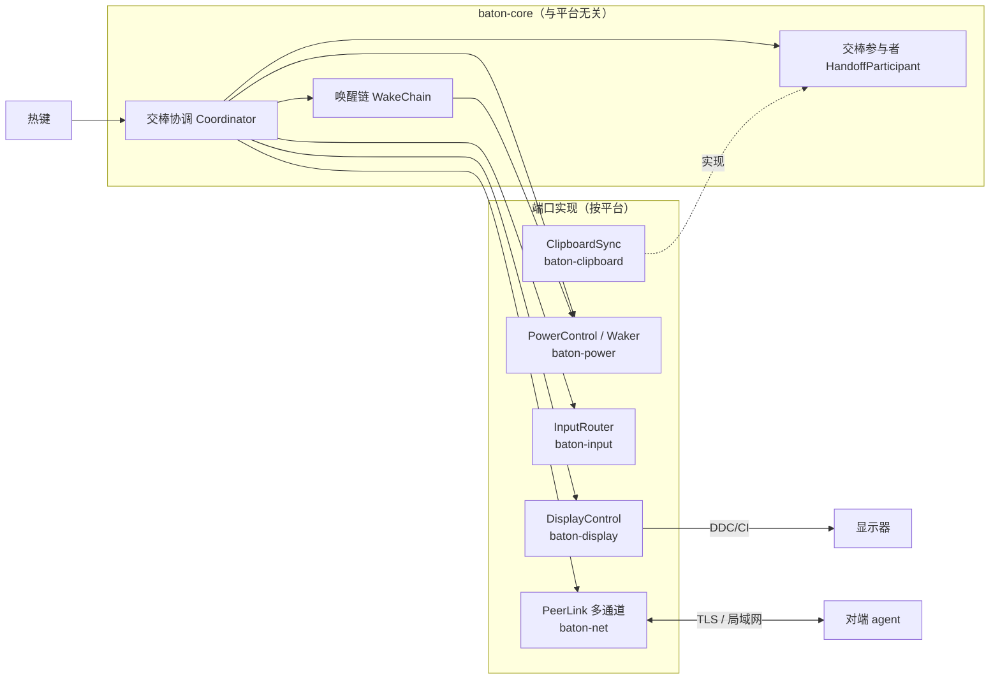

# DeskBaton 首版设计

> 状态：架构已确认（2026-10-16），工程骨架已落地。背景调研见 `docs/research/2026-10-16-kvm-input-switch-landscape.md`。
>
> 修订（2026-10-16）：
> - Mac 不再长期阻止睡眠，改为"交棒后短时保持唤醒 + 唤醒链接管"；
> - 为纯软件（非 KVM）模式和多台机器预留扩展点。
> - 默认保持唤醒策略改为"对端在线期间不睡"（`stay_awake_until = "peer_offline"`），不依赖配件；用户没有 Apple TV / HomePod，不考虑 Bonjour 睡眠代理。HID 配件降回第二期可选项。
> - 新增设备互联：互联层改为"一条 TLS 连接 + 多条逻辑通道"；首个互联能力为剪贴板同步（交棒时随身带过去）。
>
> 修订（2026-10-17）：实测 Wi-Fi 魔术包能唤醒合盖睡眠的 Mac（`docs/research/2026-10-17-mac-wifi-wol-probe.md`），`Wol` 同时用于 Mac；HID 配件降为备选。
>
> 修订（2026-10-17）：零配置（`2026-10-17-zero-config-design.md`）。`display.input_code` 变为可选，不写时由程序在本机有键鼠操作时自动学习；协议升到 v5，新增 `input_code` 消息。冲突时以零配置设计为准。
>
> 修订（2026-10-17）：配对、设备档案、mDNS 发现与面板配对改按 `2026-10-17-pairing-design.md`；agent 并入面板进程；协议升到 v3。
>
> 修订（2026-10-17）：剪贴板同步改按 `2026-10-17-clipboard-design.md`：`clipboard-rs` 读写系统剪贴板，只在交棒时带走文本 / PNG；开关在面板「本机」卡片，写入 `state.toml`，不进 `config.toml`。冲突时以剪贴板设计为准。
>
> 修订（2026-10-18）：剪贴板改为实时同步，对端离线进该对端发件箱，上线后按序送出；交棒不再附带。见 `2026-10-18-clipboard-realtime-design.md`，冲突时以该文为准。同日去掉面板「剪贴板」tab，同步与发件箱不变。
>
> 修订（2026-10-18）：离线的 Windows 直接切输入源、超时不切回；Windows `stay_awake` 用 PowerRequest 拦住系统睡眠。合盖 Mac 仍先唤醒再切。见 `2026-10-18-offline-switch-design.md`，冲突时以该文为准。
>
> 修订（2026-10-18）：用户分发改为 Mac `.dmg` + Windows NSIS 安装器，CI `pack` 出安装包，不再分发裸 exe。安装版 Mac 特权助手改 `SMAppService`。Linux 安装器留到两者定型之后。见 `2026-10-18-installer-design.md`，冲突时以该文为准。
>
> 修订（2026-10-18）：安装版面板可经 GitHub Release 程序内更新。`vX.Y.Z` tag 才发 Release；检查更新的 HTTPS 不等于把交棒端口暴露到公网。见 `2026-10-18-in-app-update-design.md`，冲突时以该文为准。
>
> 修订（2026-10-18）：`peer_offline` 按字面执行——任一已配对对端在线即 `stay_awake`，自己持棒（`taken`）不释放；Mac 同时拦住显示器空闲睡眠。`kern.wakereason` 含 `wifibt` 的暗唤醒发 `Event::NetworkWake`，短时保持并 `wake_display`，等对端上线并入长时 guard。
>
> 修订（2026-10-19）：文件快传从 M3 提前，见 `2026-10-19-file-transfer-design.md`。控制消息走长连接，数据另开一条复用 47800 端口的 TLS 文件连接（通道 `2`），不登记为对端连接；协议升到 v6。默认自动接收，传输期间两端保持唤醒。冲突时以该文为准。
>
> 修订（2026-10-19）：文件传输失败留在面板上，原路径都还在时可整次重发；剪贴板发件箱只在设备行显示条数，不展示内容。见文件快传设计第 8 节与剪贴板实时设计第 6 节。
>
> 修订（2026-10-19）：产品守则。用户画像为同一局域网内多台主机（Windows、macOS、Linux 任意组合）接一台或多台显示器，用于切换和控制显示器输入、在主机之间传输信息。产品取舍以此为依据：先保证安全，再尽量简化用户操作。多台显示器纳入适配范围，取代第 2 节的「单台显示器」：按整机交棒，本机接的所有显示器一起切给对端，细节另立设计文档。

## 1. 目标

一台显示器、两台电脑（Windows 台式机 + 合盖使用的 Apple Silicon MacBook Pro），按一个热键，把画面和键鼠一起交给另一台电脑；
**切回 Mac 时不需要开盖**。Windows 下线（关机、睡眠）后，Mac 恢复正常睡眠，不会长期不睡。

## 2. 范围

**首版做**

- 两台机器：Windows ×1 + Apple Silicon Mac ×1
- 单台显示器，通过 DDC/CI 写 VCP `0x60` 切输入源
- 键鼠由显示器内置 KVM 跟随输入源（`InputRouting::MonitorKvm`）
- Mac / Windows 在对端在线期间保持唤醒，释放条件可配置：`peer_offline`（默认，最后一个对端心跳消失才释放，自己持棒不释放）/ `duration`（交出控制权后按 `stay_awake_secs` 计时）
- 接棒方已经睡着时，按配置依次尝试唤醒方式：WoL（有线的 Windows、Wi-Fi 的 Mac）→ HID 唤醒配件（备选，第二期）→ 提示用户
- 局域网发现 + 面板上核对 6 位数字配对 + 加密通信，一条连接上多条逻辑通道；设备档案记下对端的 MAC 和 IP，供唤醒使用
- 剪贴板同步：实时把文本 / 图片发给已配对对端；对端离线时进发件箱

**预留扩展点，首版不实现**

- 纯软件键鼠模式（`InputRouting::Software`，后端为 Deskflow 进程或自研）
- 不切屏模式（`DisplayMode::None`，每台电脑各有显示器）
- 三台及以上机器（配置和协议里的对端都是列表）
- 剪贴板 HTML / RTF / 文件列表 / 视频；应用层 ACK 与发件箱落盘
- 更多互联能力（文件快传、远程电源与状态等）：新增通道 + 交棒参与者即可接入

**不做**

- Linux、Intel Mac；跨网段 / 公网

## 3. 硬件与环境假设

| 项目 | 值 | 是否已验证 |
|---|---|---|
| 显示器 | 泰坦军团 P275MV（Mini-LED，带 KVM，USB-C 65W PD） | 型号已确认 |
| Windows 接法 | DP 视频 + USB-B 上行，有线网 | 已确认 |
| Mac 接法 | 单根 USB-C（视频 + USB + 供电），Wi-Fi，合盖 | 已确认 |
| KVM 跟随输入源（DP ↔ USB-B，USB-C ↔ USB-C） | 2026-10-16 在 P275MV 上实测：切到 DP 约 4 秒后键鼠离开 Mac 并能操作 Windows，切回后回到 Mac | 已验证 |
| 输入源编码：DP = `0x0F`，USB-C = `0x1B` | P275MV 实测 USB-C = `0x0F`、DP = `0x10`，与常见值不同但不撞码 | 已验证（`docs/research/2026-10-16-p275mv-ddc-probe.md`），做成配置项 |
| 显示器只接受当前活跃输入口发来的 DDC 命令 | 按最坏情况设计；实测画面在 DP 时 Mac 的读请求只收到 Null Message | 读取已证实，写入未测 |
| 合盖 Mac 切回时睡着、KVM 键盘唤不醒 | 实测：切走时 Mac 仍有外接屏，不睡；**切回时 USB-C 重新协商，外接屏短暂消失，触发合盖睡眠**，键鼠在睡眠后才接入 | 已验证（`docs/research/2026-10-16-p275mv-ddc-probe.md`） |
| 合盖睡眠的 Mac 能被 Wi-Fi 魔术包唤醒 | 实测：睡 45 秒和约 30 分钟后，Windows 发魔术包都能唤醒，无需睡眠代理和配件；目标 MAC 须为 `en0` 当前在用的（私有）地址 | 已验证（`docs/research/2026-10-17-mac-wifi-wol-probe.md`）；超过 1 小时、电池供电未测 |

## 4. 架构总览

两台机器各运行一个 `deskbaton` agent，结构相同。核心层只依赖端口接口（trait），各平台实现由 agent 组装后注入。



**关键不变量**：任一时刻，键鼠和画面都在同一台机器上，这台机器就是"持棒方"。只有持棒方会响应热键并发 DDC 命令。

## 5. 模块

### 5.1 代码组织（Cargo workspace）

```text
crates/
  baton-core/       领域类型、协议消息、配置、端口接口、唤醒链、协调器。不依赖系统 API，可完整单测
    src/ids.rs          DeviceId / HandoffId / DisplayId / InputCode / MacAddr
    src/config.rs       Config、DisplayMode、InputRouting、PowerConfig、WakeMethod
    src/protocol.rs     Message（JSON，tag = type）
    src/state.rs        AgentState
    src/ports.rs        DisplayControl / PowerControl / Waker / InputRouter / PeerLink / ClipboardAccess
    src/channel.rs      ChannelId：control / clipboard / 预留
    src/participant.rs  HandoffParticipant：交棒时打包、接收随身数据
    src/wake.rs         WakeChain：按配置顺序尝试唤醒方式
    src/coordinator.rs  Coordinator + Ports
  baton-display/    DisplayControl：macos（经 baton-macos-sys）、windows（Dxva2）；quirks 厂商怪癖
  baton-power/      PowerControl：macos、windows；wake/ 下为 WolWaker、HidDongleWaker、PromptWaker
  baton-input/      InputRouter：MonitorKvmRouter；software/ 下为 SoftwareRouter + InputShareBackend（deskflow、native）
  baton-net/        identity（持久化 TLS 身份）、pairing（配对码与信任判定）、store（设备档案 peers.toml）、
                    discovery（mDNS）、iface（网卡 MAC）、frame（带通道号的分帧）、mux（控制优先的发送调度）、TcpPeerLink
  baton-clipboard/  ClipboardAccess（基于 clipboard-rs）+ ClipboardSync 参与者
  baton-files/      文件快传运行时：收发线程、.part 落盘、接收位置与剩余空间、传输期 AwakeGuard
  baton-macos-sys/  ObjC 胶水（native/*.m）+ FFI 声明，只在 macOS 编译
  baton-agent/      库 `Agent::start`：恢复睡眠设置、加载身份与档案、启动链路，协调器跑在独立线程。
                    无界面程序 deskbaton：主线程运行系统事件循环（macOS 为 native 中的 NSApplication，
                    Windows 为消息循环），全局热键依赖它分发；`--stdin` 可用回车代替热键调试；
                    Ctrl+C 经 Shutdown 事件退出，退出前释放保持唤醒
  baton-cli/        调试工具 deskbaton-cli：displays / get-input / set-input / wol / stay-awake
  baton-gui/        面板 deskbaton-gui（Tauri 2）：进程内运行 agent；显示器信息、切换输入源、设备配对。
                    设计见 `2026-10-16-display-panel-design.md`、`2026-10-17-pairing-design.md`
```

**扩展方式**：新增一种能力只需新增对应 trait 的实现并在 agent 里注入，不改核心层。例如：

- 纯软件模式：实现 `InputShareBackend`；
- 新的唤醒方式：实现 `Waker` 并在 `WakeMethod` 加一个枚举值；
- 新的互联能力：分配一个 `ChannelId`，实现 `HandoffParticipant`（交棒时触发）或直接收发该通道的帧（随时触发）；
- Linux：给 `DisplayControl` / `PowerControl` 加 `linux` 模块。

### 5.2 DisplayControl

```rust
pub trait DisplayControl: Send + Sync {
    fn list(&self) -> Result<Vec<DisplayInfo>>;
    fn get_input(&self, display: &DisplayId) -> Result<InputCode>;   // 多数显示器只在本机是活跃输入时响应
    fn set_input(&self, display: &DisplayId, input: InputCode) -> Result<()>;
}
```

| 平台 | 实现 |
|---|---|
| Windows | `GetPhysicalMonitorsFromHMONITOR` + `GetVCPFeatureAndVCPFeatureReply` / `SetVCPFeature`（Dxva2） |
| macOS | 移植 m1ddc（MIT）的 IOAVService 读写到 `baton-macos-sys/native/ddc.m` |

目标显示器由 `DisplayInfo::select` 选择：配置为 `auto` 时要求恰好一台，否则按型号子串匹配。

- macOS 的 `DisplayId` 取 framebuffer 的 EDID UUID；同一 UUID 出现多次时，后出现的追加 `#序号`。
- Windows 的 `DisplayId` 为 `\\.\DISPLAYn#序号`。Dxva2 给出的描述多为「通用即插即用监视器」，型号和序列号改从注册表 `Enum\DISPLAY\…\Device Parameters\EDID` 解析；读不到 EDID 时退回 Dxva2 描述。
- MCCS 报文的拼装和回包校验在 Rust 侧（`baton-display/src/mccs.rs`），原生层只做原始 I2C 读写。回包的长度、校验和、VCP 编码任一不对都按错误处理，不当作编码 `0`；读写失败共尝试 3 次，间隔 200 毫秒。
- 输入源（VCP `0x60`）只取低字节。

### 5.3 PowerControl 与唤醒链

```rust
pub trait PowerControl: Send + Sync {
    fn stay_awake(&self, duration: Duration) -> Result<AwakeGuard>;  // 含合盖睡眠；到期或 guard 释放后恢复；Duration::MAX 表示直到释放
    fn wake_display(&self) -> Result<()>;
    fn restore_sleep(&self) -> Result<()>;                           // agent 启动时恢复上次异常退出的残留
}
pub trait Waker: Send + Sync {
    fn method(&self) -> WakeMethod;
    fn wake(&self, target: &WakeTarget) -> Result<WakeOutcome>;      // Sent / NeedsUser(提示)
}
```

**Mac 的 `stay_awake`**：执行 `pmset -a disablesleep 1`（置 `SleepDisabled`）关闭包括合盖睡眠在内的所有睡眠，同时持有 `PreventUserIdleSystemSleep` 和 `PreventUserIdleDisplaySleep` 断言（后者等价 `caffeinate -d`，避免交出控制权期间显示器空闲关掉、切回时 USB-C 无视频）；恢复时执行 `pmset -a disablesleep 0` 并释放断言。`SleepDisabled` 已在 MacBook Pro + P275MV 上验证可挡住切回时的合盖睡眠。

- 不使用 `IOPMrootDomain` 的 `kPMSetClamshellSleepState`：它写的是 powerd 自己管理的位，外接屏消失时 powerd 会把它改写回 0，内核随即判定合盖睡眠。能被 powerd 计入的 `AppliesOnLidClose` 断言需要 Apple 私有 entitlement。
- 特权来源：开发版一次性写入 `/etc/sudoers.d/deskbaton`，只允许当前用户免密码执行 `/usr/bin/pmset -a disablesleep 1` 和 `/usr/bin/pmset -a disablesleep 0` 两条完整命令；agent 用 `sudo -n` 调用。由 `deskbaton-cli sleep-helper install / uninstall / status` 管理，写入前用 `visudo -cf` 校验。安装版（`.app`）改为 `SMAppService` 登记的助手，只执行同一对命令，见 `2026-10-18-installer-design.md`。
- 规则未安装、`sudo -n` 失败、或安装版助手未允许时，`stay_awake` 只持有断言并记录警告，不阻断交棒；托盘 / 底栏提示见安装器设计。
- `SleepDisabled` 重启后仍然保留，所以标记文件放在 `~/Library/Application Support/DeskBaton/`，不放临时目录；只有标记存在时 `restore_sleep` 才执行 `disablesleep 0`，不改动用户自己设置的值。

- 多个 guard 可以重叠，按引用计数共用一个系统级开关，最后一个释放或到期时恢复；释放会等待正在进行的恢复完成，保证进程正常退出前已恢复。
- 开启时写标记文件，恢复后删除；agent 启动时发现标记就执行恢复（`restore_sleep`），处理崩溃或被强杀的情况。
- `wake_display` 用 `IOPMAssertionDeclareUserActivity` 声明本地用户活动。

**Windows 的 `stay_awake`**：`PowerRequestSystemRequired` 拦住系统睡眠，不拦显示器；进程退出即释放。人在 Mac 上时 Windows 不会因空闲睡着。详见 `2026-10-18-offline-switch-design.md`。

使用场景：

1. 默认 `stay_awake_until = "peer_offline"`：任一已配对对端在线就持有长时 guard（`Duration::MAX`），**自己变成持棒方（`taken`）也不释放**；最后一个对端心跳消失才释放。设为 `"duration"` 时仍只在交出控制权后保持 `power.stay_awake_secs` 秒。Mac 与 Windows 都执行。
2. 收到 `prepare` 时再叠一把约 60 秒的短时 guard 并 `wake_display`，防止合盖 Mac 在画面切过来前睡回去。短时 guard 随接棒结束而释放，长时 guard 仍按上一条。
3. Mac 从睡眠醒来且 `kern.wakereason` 含 `wifibt`：发 `Event::NetworkWake`，`wake_display` 并短时 `stay_awake`（约 60 秒），等对端上线后并入第 1 条。`rtc` 定时暗唤醒不发该事件，不当成交棒。

**唤醒链**（`WakeChain`，顺序由 `power.wake_chain` 配置）：

| 方式 | 适用对象 | 首版状态 |
|---|---|---|
| `Wol` | 有线网络的 Windows；Wi-Fi 下合盖睡眠的 Mac | 已实现；Mac 已实测可用 |
| `HidDongle` | 合盖睡眠的 Mac：常插在 Mac 上的 USB / BLE HID 配件，收到局域网指令后模拟一次按键。因为它在 Mac 睡眠前就已接入，可以作为唤醒源 | 接口已留，第二期备选（Wi-Fi 魔术包不可用的网络环境） |
| `Prompt` | 兜底 | 已实现 |

**用 `Wol` 唤醒 Mac**（实测见 `docs/research/2026-10-17-mac-wifi-wol-probe.md`）：

- 前提：「唤醒以供网络访问」开启（`pmset womp 1`），入睡前内核有 `MAGICWAKE en0` 断言。airportd 的「WoW is not active」不代表收不到魔术包，不作判据。
- 目标 MAC：`en0` 当前在用的地址。启用私有 Wi-Fi 地址时它不等于硬件地址，所以由 agent 在 `hello.wol_mac` 上报承载该连接的网卡当前 MAC，对端写入设备档案；配置里的 `peers[].wol_mac` 只作兜底。该网络的私有地址须为「固定」，「轮换」会让档案里的地址失效。
- 发送：同时发往 `255.255.255.255`、本机各网卡的子网广播和对端最后已知的单播 IP（取自设备档案）的 UDP 9。
- 魔术包只把 Mac 唤到暗唤醒。平台在醒来时读 `kern.wakereason`，含 `wifibt` 则发 `Event::NetworkWake`：协调器立刻 `wake_display` 并短时 `stay_awake`，等对端心跳后并入「对端在线」长时 guard。
- 系统约每 15 分钟会因 `rtc` 定时任务暗唤醒一次，持续几十秒后自行睡回。agent 不能把醒来本身当作交棒信号，也不为 `rtc` 发 `NetworkWake`。

USB-C 链路上的 KVM 键盘、蓝牙 HID 两条路径不再作为 M0 必测项。

### 5.4 InputRouter

```rust
pub trait InputRouter: Send + Sync {
    fn acquire(&self) -> Result<()>;                 // 本机成为持棒方后
    fn release(&self, to: &DeviceId) -> Result<()>;  // 本机交出控制权前
}
```

- `MonitorKvmRouter`：空实现，键鼠由显示器 KVM 跟随。
- `SoftwareRouter`：委托给 `InputShareBackend::focus(target)`。后端有两种：Deskflow（独立进程，保持与 GPL-2.0 代码的进程隔离）和自研（参考 Lan Mouse）。

### 5.5 PeerLink

细节见 `2026-10-17-pairing-design.md`，这里只列要点。

- **身份**：首次启动生成自签证书并持久化，证书指纹即设备身份。双向 TLS 1.3，TLS 层只验证对端持有证书私钥（加密库用 ring，不用含 OpenSSL 许可证成分的 aws-lc）。
- **发现**：mDNS 服务类型 `_deskbaton._tcp.local.`，默认端口 47800，TXT 带证书指纹。
- **配对**：握手时先交换承诺和随机数，双方面板显示同一个由两端指纹和随机数派生的 6 位数字，双方都同意后固定对方指纹，写入设备档案 `peers.toml`。
- **令牌**：两端配置相同的 `network.token` 时，`hello.auth`（令牌对「角色、发送方名称、双方证书指纹」的 HMAC-SHA256）校验通过即自动配对，不弹窗。中间人终止 TLS 时两端看到的指纹不同，证明无法通过。
- **传输**：TCP + TLS，一对机器之间只有一条连接，上面跑多条逻辑通道，见 5.7。
- **心跳**：每 2 秒一次，走控制通道；连续 3 个周期收不到任何帧就判定对端离线。
- **拨号**：自动拨号档案里的设备（有令牌时还有配置了 `address` 的对端），每 2 秒重试；地址依次取 mDNS、档案、配置。双方都发出并收到 `pair_accept` 后才登记连接、报告上线。双方同时互拨时，两端都保留由名称较小一方拨出的连接，被替换的连接静默关闭，不报离线。

### 5.6 协议消息

| 消息 | 方向 | 含义 |
|---|---|---|
| `hello { device_id, protocol_version, platform, input_code, wol_mac, listen_port, auth? }` | 双向 | 交换身份、操作系统（`macos` / `windows` / `linux` / `other`，供界面标识设备）、本机输入源编码、WoL MAC（承载该连接的网卡当前地址）、监听端口、令牌证明（可选） |
| `pair_commit` / `pair_nonce` / `pair_reveal` | 握手 | 配对码的承诺与随机数交换 |
| `pair_pending` / `pair_accept` | 双向 | 需要用户确认配对 / 已信任对方 |
| `heartbeat { state }` | 双向 | 状态同步 |
| `prepare { handoff_id }` | 持棒方 → 接棒方 | 准备接棒 |
| `ready { handoff_id }` | 接棒方 → 持棒方 | 已点亮显示输出 |
| `taken { handoff_id }` | 接棒方 → 持棒方 | 已确认成为活跃输入 |
| `abort { handoff_id, reason }` | 双向 | 放弃本次交棒 |

以上消息都走控制通道。文件快传的 `file_offer` / `file_accept` / `file_reject` / `file_cancel` / `file_result` 也走控制通道，但由文件会话处理、不进协调器；`file_hello` 只作文件连接的首帧。见 `2026-10-19-file-transfer-design.md` 第 5 节。

### 5.7 多通道传输

**帧格式**

```text
| len: u32 大端 | channel: u8 | kind: u8 | payload |
  len = 1 + 1 + payload 长度，单帧不超过 1 MiB
```

| channel | 用途 | kind |
|---|---|---|
| `0` control | 交棒、心跳、状态 | `0` = JSON `Message` |
| `1` clipboard | 剪贴板随身数据 | `0` Begin（JSON 元数据）/ `1` Chunk（原始字节）/ `2` End / `3` Cancel |
| `2` file | 文件快传，只在文件连接上出现（见 `2026-10-19-file-transfer-design.md`） | `0` Manifest / `1` FileBegin / `2` Chunk / `3` FileEnd / `4` Done |
| `3`–`255` | 预留（远程状态等） | 由各通道自行定义 |

**数据通道的传输单元**是一次 transfer：Begin 帧携带 `{ transfer_id, handoff_id, format, total_len, sha256 }`，之后是若干 Chunk 帧（每块 64 KiB），最后是 End 帧。接收方校验长度和哈希后才交付。任一方可以发 Cancel 中止。

- Chunk / End / Cancel 的负载以 8 字节大端 `transfer_id` 开头（Chunk 后接原始字节），同一通道上交替发送的多个 transfer 据此区分。
- 单次 transfer 上限 256 MiB（`MAX_TRANSFER_LEN`），超过时发送方拒绝、接收方丢弃；参与者自己的上限（如 `clipboard.max_bytes`）更小。
- 线上格式版本 `PROTOCOL_VERSION = 6`（v1 为不带通道号的 `len | JSON`；v2 为令牌认证、无配对握手；v3 的 `hello` 没有 `platform`；v4 没有 `input_code` 消息；v5 没有文件快传）。

**发送调度**（`mux`）：每条连接一个写任务，维护两个队列。
- 控制队列永远优先发送；
- 数据队列按 transfer 轮转，每次只发一个 Chunk。

这样控制帧最多只需要等一个 64 KiB 的块，大数据堵不住交棒和心跳。

**为什么不用 QUIC**：局域网里单条 TCP 的队头阻塞影响很小，用分块加优先级就够了；TCP 依赖更少，在 Windows 防火墙下也更省心。

### 5.8 交棒参与者与剪贴板同步

```rust
pub trait HandoffParticipant: Send + Sync {
    fn channel(&self) -> ChannelId;
    /// 交出控制权前调用：返回要带给接棒方的数据（None 表示本次不带）
    fn pack(&self, to: &DeviceId) -> Result<Option<Payload>>;
    /// 接棒方收到完整数据后调用
    fn unpack(&self, from: &DeviceId, payload: Payload) -> Result<()>;
}
pub trait ClipboardAccess: Send + Sync {
    fn read(&self) -> Result<Option<ClipboardContent>>;   // Text(String) | ImagePng(Vec<u8>)
    fn write(&self, content: &ClipboardContent) -> Result<()>;
}
```

```rust
pub trait PeerLink: Send + Sync {
    fn send(&self, to: &DeviceId, msg: &Message) -> Result<()>;                // 控制通道，优先发送
    fn send_data(&self, to: &DeviceId, channel: ChannelId,
                 handoff_id: HandoffId, payload: Payload) -> Result<()>;      // 数据通道，排队后立即返回
    fn set_local_state(&self, state: AgentState);                              // 随心跳发给对端
}
pub enum Event { Hotkey, PeerOnline(PeerInfo), PeerOffline(DeviceId),
                 Message { from, message }, Data { from, channel, handoff_id, payload }, Shutdown }
```

握手和心跳由链路自己维护：协调器在交棒中会等待最长 `handoff_timeout_ms`，心跳不能依赖它。链路收到的一切以 `Event` 送入协调器的事件队列；热键也是一种 `Event`。面向用户的提示经 `Notifier` 端口输出。

**协调器**在交棒第 5 步并行调用所有参与者的 `pack`，结果经各自的通道发送。参与者失败只记日志，**不影响交棒**。

**ClipboardSync / ClipboardBridge**（`baton-clipboard`）：见 `2026-10-18-clipboard-realtime-design.md`。实时经通道 `1` 发送，`handoff_id = 0`；`pack` 不再带数据。失败仍不得阻断交棒。

## 6. 交棒流程

### 6.1 状态

`Holding`（持棒）/ `Idle`（不持棒）/ `HandingOff(id)` / `Receiving(id)`。
启动时 `refresh_state`：`get_input` 读到本机的输入源编码即为 `Holding`，否则为 `Idle`。`Idle` 时按下热键会先重新判定一次，避免上次交棒超时后画面才切过来、两边都不响应热键。

协调器是事件驱动的状态机：`handle(event, now)` 处理事件，`tick(now)` 处理超时和轮询，`next_deadline()` 给出下一次需要 `tick` 的时间。所有等待都不阻塞事件处理，测试用假时钟驱动。

### 6.2 流程（持棒方 A 按下热键）

1. A 检查 B 的心跳。
2. B 离线时，A 运行唤醒链。B 是 Windows / Linux / 其它：有输入源编码就立刻 `set_input`，不等 `ready` / `taken`，超时不切回（见 `2026-10-18-offline-switch-design.md`）。B 是 Mac 或档案里还没有 `platform`：结果为 `Sent` 就等 B 的心跳（最多 30 秒）；结果为 `NeedsUser` 就弹通知并结束。
3. B 上线（或被唤醒）后，A 立即发 `prepare`（上一步已经直接切走的除外）。
4. B 收到 `prepare` 后先 `stay_awake(60s)`（叠在「对端在线」长时 guard 上，不是唯一挡板），再调用 `wake_display()`，回 `ready`。A 等 `ready` 最多 3 秒。B 正在交棒或自己持棒时回 `abort`。
5. A 调用 `input.release(B)`，再按 `stay_awake_until` 同步保持唤醒（`peer_offline` 下对端已在线则长时 guard 早已持有；`duration` 从此时计时）。
   同时并行调用各交棒参与者的 `pack`，经数据通道发给 B，不等待传输完成。
6. A 调用 `set_input(B 的输入源编码)`；KVM 模式下，键鼠随之切给 B。
7. B 每 300 毫秒轮询一次 `get_input`，读到自己的编码就调用 `input.acquire()`，回 `taken`，进入 `Holding`。第 4 步的 60 秒短时 guard 随接棒结束释放；`peer_offline` 的长时 guard 不释放。最长等 8 秒。
8. A 收到 `taken` 后进入 `Idle`。`peer_offline` 下长时 guard 仍保持到 B 离线；A 重新接棒成为持棒方时也不释放。`duration` 下第 5 步的 guard 到期后恢复睡眠。
9. A 超时没收到 `taken`（或 B 在此之前掉线、回 `abort`）：尝试 `set_input(自己的编码)` 切回、收回键鼠，再按 `get_input` 重新判定状态，并通知报错。第 2 步对非 Mac 离线直接切的那次不走这一步。B 轮询超时则回 `abort` 并进入 `Idle`。
10. B 收到完整的参与者数据后调用对应参与者的 `unpack`（可能早于或晚于 `taken`）。交棒被中止时，B 丢弃未交付的数据。

## 7. 错误处理

| 场景 | 处理 |
|---|---|
| DDC 写失败 | 重试 2 次，间隔 200 毫秒；仍失败就中止并通知 |
| `stay_awake` 拿不到 `SleepDisabled`（特权助手未授权或执行失败） | 记录警告，继续交棒（合盖的 Mac 切回时会睡着，只能开盖）；托盘提示授权特权助手 |
| 唤醒链全部失败 | 对端是 Mac：通知用户手动唤醒。对端是 Windows 等且已有输入源编码：仍切画面，通知里附上原因 |
| 收到 `taken` 前对端掉线 | 按超时处理，尝试切回 |
| agent 崩溃或退出 | `AwakeGuard` drop 时恢复；下次启动时检查并清理残留的 `SleepDisabled` |
| 显示器"自动选择输入源"把画面跳回去 | 第 7 步超时后报错，提示关闭该选项 |
| 剪贴板读取、传输或写入失败 | 只记日志并在托盘提示，不影响交棒 |
| 数据传输中途断线 | 接收方丢弃该 transfer；不重传，下次交棒时再带 |

## 8. 配置

路径：macOS 为 `~/Library/Application Support/DeskBaton/config.toml`，Windows 为 `%APPDATA%\DeskBaton\config.toml`。所有字段都有默认值。

```toml
name = "macbook"        # 本机名称，即对端的 peers[].name；默认取主机名
hotkey = "Ctrl+Alt+Space"
handoff_timeout_ms = 8000

[network]
port = 47800
# token = "两端相同的随机字符串"   # 可选：两端相同时自动配对，不弹窗

[display]
mode = "ddc"            # ddc | none
match = "auto"          # 或 EDID 型号子串
input_code = 0x1B       # 可选：本机在显示器上对应的输入源编码；不写时自动学习（见零配置设计）

[[display.inputs]]      # 显示器面板的输入源按钮；默认 DP 0x0F / HDMI1 0x11 / HDMI2 0x12 / USB-C 0x1B
label = "DP"
code = 0x0F

[input]
mode = "monitor_kvm"    # monitor_kvm | software（需再写 backend = "deskflow" | "native"）

[power]
stay_awake_until = "peer_offline"   # peer_offline | duration
stay_awake_secs = 300               # 仅 duration 模式使用
wake_chain = ["wol", "hid_dongle", "prompt"]

[[peers]]
name = "windows-desktop"
address = "192.168.1.20:47800"
wol_mac = "aa:bb:cc:dd:ee:ff"
```

`[[peers]]` 只作兜底（地址、WoL MAC），配对后可以不写。配对信息与设备档案存于同目录的 `peers.toml`，本机身份存于 `identity/`，都由程序维护，不写在配置文件里。

## 9. 测试策略

- **baton-core**：用假实现驱动协调器和唤醒链，覆盖正常交棒、各类超时、掉线、唤醒失败、并发热键。
- **baton-net**：分帧编解码单测；`mux` 调度单测（大数据传输期间控制帧的等待不超过一个块）；两个 agent 在本机回环地址上跑通配对、心跳、交棒消息和一次剪贴板 transfer。
- **baton-clipboard**：用假的 `ClipboardAccess` 测防回传、超限跳过、敏感内容跳过。
- **CI**：macOS / Windows / Linux 三平台跑 `fmt`、`clippy -D warnings`、`test`（Linux 排除 `baton-gui`）。`main` 或手动触发时，Mac / Windows 再打安装包（`.dmg` / NSIS），见 `2026-10-18-installer-design.md`。不上传裸 exe。
- **Windows 自验**（不必换机器）：Mac 上 `scripts/check-windows.sh` 用 cargo-xwin 对 `x86_64-pc-windows-msvc` 跑 clippy；`scripts/verify-ci.sh` 把工作区快照强推到 `agent/verify-<分支>` 并等 CI，`--pack` 时再打安装包，Windows runner 上由 `scripts/smoke-windows.ps1` 静默安装、检查 HKCU Run 键、启动确认安装版、静默卸载并检查清理。agent 分支的运行互相取消，`main` 不受影响。DDC、配对、剪贴板等需要显示器或对端的行为不在此覆盖。
- **硬件验收清单**（手动）：
  1. 合盖 Mac 切到 Windows 后，5 分钟内切回，不需要开盖；
  2. 合盖 Mac 切走并睡眠超过 1 小时后，从 Windows 交棒，Mac 被唤醒并接管键鼠，不需要开盖；
  3. Windows 睡眠时从 Mac 切过去，WoL 生效；
  4. 关闭 Mac 上的 agent 后，系统睡眠策略恢复正常；
  5. 在 Windows 复制一段文字和一张截图，Mac 在线时立刻能粘贴、不必先切换；从密码管理器复制的密码不会被同步。

## 10. 里程碑

| 阶段 | 内容 | 退出条件 |
|---|---|---|
| M0 原型 | ① Mac 端 DDC 读写；② Windows 端 DDC 读写；③ 实测 P275MV 的输入源编码和 KVM 跟随；④ Mac `stay_awake` 两种机制；⑤ 实测不需要配件的唤醒路径（已确认 Wi-Fi 魔术包可行） | `deskbaton-cli` 在两端完成切换；验收清单第 1 项通过；明确合盖睡眠 Mac 的可行唤醒方式 |
| M1 命令行交棒 | 无界面 agent，写死对端地址，用预共享令牌代替配对；多通道帧格式与 `mux`；`peer_offline` 保持唤醒策略 | 热键完成双向交棒；验收清单第 1、3、4 项通过 |
| M2 可用版本 | 剪贴板实时同步；agent 并入面板进程；mDNS 发现、面板配对、设备档案；开机自启、通知；Mac 经 Wi-Fi 魔术包被唤醒后接棒；Mac / Windows 安装器 | 验收清单第 1–5 项、配对 / 剪贴板实时 / 安装器设计验收清单通过；能用安装包装上，登录后面板自起 |
| M3 扩展 | HID 唤醒配件（魔术包不可用时的备选）、文件快传、软件键鼠模式、不切屏模式、多机器、Linux | 另立设计文档 |

## 11. 风险

| 风险 | 影响 | 应对 |
|---|---|---|
| Wi-Fi 魔术包唤醒在部分环境失效（路由器不转发广播、长时间睡眠后网卡掉线、私有地址轮换等） | Mac 已经睡着时（Windows 刚开机等）只能开盖 | 默认策略让 Mac 在 Windows 在线期间不睡，覆盖日常使用；超过 1 小时睡眠待实测；HID 配件作为第二期备选 |
| 敏感剪贴板标记各平台不统一 | 可能误同步密码 | 首版只认最常见的约定类型；在设置里提供"只同步文本"或关闭同步的开关 |
| 合盖控制必须用 root（无需 root 的 IOKit 接口已证实无效） | 需要特权助手，安装体验变差；`SleepDisabled` 是持久的系统设置，残留会让 Mac 一直不睡 | 首次运行引导授权；guard 释放、agent 启动时都恢复（标记文件兜底） |
| macOS 应用公证需要 Apple 开发者账号 | 未公证的应用首次打开会被拦 | 先在文档里写明处理方式，后续再申请账号 |
| GPL 许可证 | 对外分发必须开源 | 已确定以 GPL 开源 |
